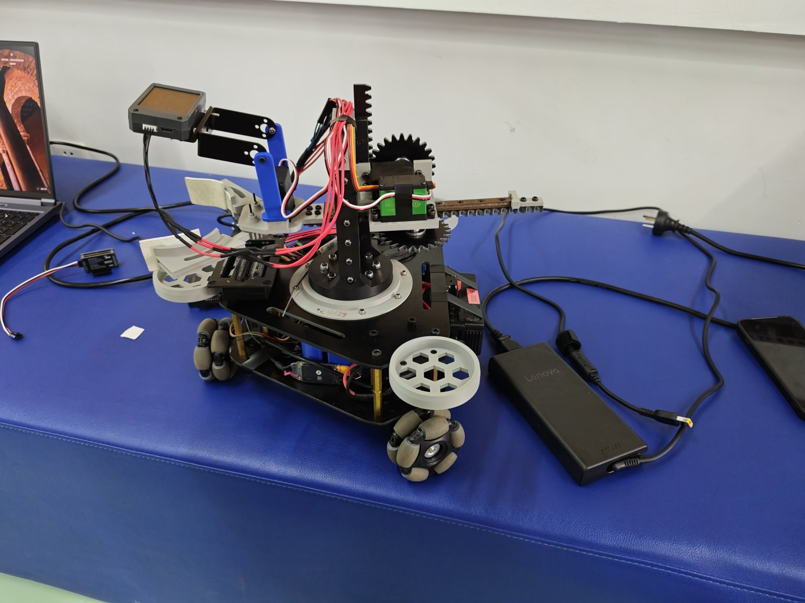

# 机器人校赛 · 手动机器人视觉系统

厦门大学机器人校赛参赛作品（手动机器人组）。我做的是视觉分系统：
K230 板子装在小车云台上跟着机械臂走，实时看场地，找到目标方块，
算出「爪夹中心到方块中心」的像素偏移，通过串口发给电控，
电控据此把爪移到方块正上方再夹取。

## 板子上跑的流程

1. 相机取 640x480 画面，画面直接显示在板载 ST7701 触摸屏上，站车前就能看
2. YOLOv8（单类 box，imgsz 480，跑在 K230 的 KPU 上）出检测框
3. 用框中心减去 GRASP_PX（爪夹中心在画面里对应的那个像素，装车后标定一次），
   得到的就是这一帧的实时剩余偏移，不需要识别爪，也不需要跨帧记账
4. 没框时先用颜色掩膜兜底（约 1ms，误差 3~12px），颜色也没有才沿用上一帧的框（最多 0.6 秒）
5. 偏移量和种类打成 8 字节帧，从 UART3 发出去

## 串口协议

8 字节固定帧：

    0xAA 0x55 dx_hi dx_lo dy_hi dy_lo kind cs

- dx、dy：有符号 16 位，方块中心相对爪夹中心的像素偏移
- kind：0=本帧没识别到/不可用，1=ball，2=cone，3=block
- cs：校验字节

## 目录

    k230/    板子端脚本
      main_new3.py   视觉主程序（识别 + 算偏移 + 发串口）
      jiaoben.py     在板子上拍数据集用的小工具，点屏幕拍一张存 /sdcard
      tongxin.py     串口收发测试
      dp.py          模型加载检查（打印 kmodel 的输入输出描述）
      yunxing.py     开机自启开关
    train/   模型训练部分
      build_box_dataset.py  把标注整理成 YOLO 数据集
      make_empty_labels.py  给负样本生成 0 字节标注
      mask_overlay_text.py  抹掉图上的干扰文字
      data.yaml             数据集配置
      TRAIN.md              训练参数和完整流程
    assets/  实物照片

## 说明

- 数据集（400 多张现场图）和训练好的权重（.kmodel）不进仓库，体积大，也不适合公开。
  数据和权重都在本机，训练过程见 train/TRAIN.md。
- 板子端脚本里的 /sdcard/... 路径是 K230 上的路径，不是电脑上的路径。
- main_new3.py 开头有 GRASP_PX 的标定方法和一个已知坑（跑之前先 Ctrl-D 软复位），
  上板前值得先读一遍。
